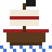
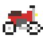
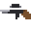
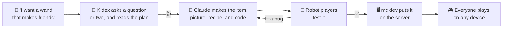

<p align="center">
  
</p>

<p align="center">
  
  
  
  
</p>

# ⛏️ Family Minecraft Mods

**Our kids dream up the mods. Claude helps build them. Then the whole family plays them together.**

A wand that turns a creeper into a tame wolf. A pirate ship your friends sail with you. A golden feather for flying. A kid can ask for any of them in one sentence. This repo holds the mods, a private server the whole family joins from whatever they have (Switch included), and the tools that take a new mod from idea to game in an evening: kids say what they want, Claude builds it, robot players test it, and it's on the server.

## The mods

<table>
  <tr>
    <td align="center" width="33%" valign="top">
      <br>
      <b><a href="./addons/magic-wand">Magic wand</a></b><br>
      <sub>Casts spells at mobs: fire, push them far away, or turn a creeper into a tame wolf.</sub>
    </td>
    <td align="center" width="33%" valign="top">
      <br>
      <b><a href="./addons/pirate">Pirates</a></b><br>
      <sub>Sail your own ship with a crew of pirate friends who follow you, fight, and sail along.</sub>
    </td>
    <td align="center" width="33%" valign="top">
      <br>
      <b><a href="./addons/double-jump">Golden feather</a></b><br>
      <sub>Every feather is one flap in the air. Hold jump to glide down slowly.</sub>
    </td>
  </tr>
  <tr>
    <td align="center" width="33%" valign="top">
      <br>
      <b><a href="./addons/rainbow-cookie">Rainbow cookie</a></b><br>
      <sub>Heals you to full, and makes you fast and bouncy.</sub>
    </td>
    <td align="center" width="33%" valign="top">
      <br>
      <b><a href="./addons/motorcycle">Motorcycle</a></b><br>
      <sub>Hop on and ride, with a speedometer.</sub>
    </td>
    <td align="center" width="33%" valign="top">
      <br>
      <b><a href="./addons/power-tools">Power tools</a></b><br>
      <sub>A drill through deepslate, a chainsaw through trees, and a power shovel. Brrrr.</sub>
    </td>
  </tr>
  <tr>
    <td align="center" width="33%" valign="top">
      <br>
      <b><a href="./addons/weapons">Weapons</a></b><br>
      <sub>A pistol, a scoped rifle, a machine gun, and grenades that throw further the longer you hold.</sub>
    </td>
    <td align="center" width="33%" valign="top">
      <br>
      <b><a href="./addons/football">Football</a></b><br>
      <sub>Kick a ball into goals you build, and a match starts.</sub>
    </td>
    <td align="center" width="33%" valign="top">
      <br>
      <b><a href="./addons/lantern">Hand lantern</a></b><br>
      <sub>A light that walks with you, even from your pocket.</sub>
    </td>
  </tr>
</table>

And more: [NPCs](./addons/npc) you boss around in plain words (`./mc npc "build a tower next to me"`), [trampolines](./addons/trampoline) you build like a Nether portal, [party commands](./addons/party-commands), a [welcome](./addons/welcome) message, and [game stats](./addons/game-stats) for the family dashboard. The full list is in [What's inside](#whats-inside).

## From an idea to the server in one evening



## Why it works for a family

- **Kids make the mods, by talking.** With [Kidex](https://github.com/mthines/kidex) (`./mc kidex`), a kid presses space and says what they want. Kidex asks a question or two with big buttons, reads its plan out loud, and builds once they say 👍. They watch the files appear, answer a quiz while they wait, and get confetti when it works. Grown-ups use Claude Code in the same folder.
- **Everyone plays together, on anything.** One private server for Switch, iPad, phones, and PCs. It sends the mods to every device that joins, so nobody installs anything.
- **Robot players try the mods first.** A mod comes with a test that plays it the way a kid would, with simulated players in a test world of its own: nearly 80 of them, from "the drill breaks deepslate at once" to "the friend spell makes a mob friendly". The family world is never touched, and nobody gets kicked.
- **One screen runs it all.** `./mc dev` shows who's online and puts everything on one key: a kit of any mod (`k`), day (`d`), no more monsters (`e`), another world (`w`), an NPC (`n`). Kids can drive it, and in Kidex it sits right next to the mod they're making.
- **Nothing gets lost.** Every world stays saved: play one, switch to another, come back later. Every mod is in git.
- **A family dashboard.** [`game-stats`](./addons/game-stats) counts what everyone digs, builds, beats, and eats, and how they die, for a [Dash0 dashboard](./server/README.md#family-dashboard): who dug the most this week?

## What's inside

| Add-on | What it does | How it's made |
| --- | --- | --- |
| [`welcome`](./addons/welcome) | Says hi when you join | Code: 10 lines of JavaScript |
| [`rainbow-cookie`](./addons/rainbow-cookie) | A new cookie that heals you to full life and makes you fast and bouncy. Craft it from a cookie, sugar, and glow berries. | Item + picture + recipe + a little code |
| [`trampoline`](./addons/trampoline) | Build slime blocks with a wooden edge, like a portal, and get a trampoline. Bigger ones bounce higher. You get the blocks in a chest when you first join. | Code, with tests |
| [`party-commands`](./addons/party-commands) | `/function party` and `/function sunny`, and 9 dirt crafts into 1 diamond | No code: commands and a recipe |
| [`game-stats`](./addons/game-stats) | Counts what everyone digs, builds, beats, eats, and how they die, plus minutes played, blocks travelled, level-ups, and Nether trips, for the [Dash0 dashboard](./server/README.md#family-dashboard) | Code, with tests |
| [`double-jump`](./addons/double-jump) | Golden feathers: each one is a flap in the air, and holding jump glides you down slowly. You get 10 when you join. | Item + picture + recipe + code, with tests |
| [`football`](./addons/football) | A ball you kick by hitting it. Build two goals of the same size and a match starts; the ball in a goal scores. | Item + entity + model + pictures + recipe + code, with tests |
| [`lantern`](./addons/lantern) | A hand lantern that lights up around you while it's anywhere in your inventory | Item + picture + recipe + code, with tests |
| [`motorcycle`](./addons/motorcycle) | A motorcycle you place, ride, and pick up again, with a speedometer | Item + entity + model + pictures + recipe + code, with tests |
| [`power-tools`](./addons/power-tools) | A drill that breaks stone and deepslate almost at once, a chainsaw for trees, and a power shovel, with machine noises | Items + pictures + recipes + code, with tests |
| [`weapons`](./addons/weapons) | A pistol, a scoped rifle, a machine gun, bullets, and grenades | Items + entity + model + pictures + recipes + code, with tests |
| [`magic-wand`](./addons/magic-wand) | A purple wand with a star that casts spells at mobs: fire hurts, push throws them far away, and friend turns them into a tame wolf. Sneak and right-click to switch spell. | Item + picture + recipe + code, with tests |
| [`laser-gun`](./addons/laser-gun) | A blue laser gun. Right-click shoots a glowing blue beam that hurts mobs up to 40 blocks away. Craft it from 2 iron ingots and a diamond. | Item + picture + recipe + code, with tests |
| [`npc`](./addons/npc) | NPCs that join like players and do what they're told: `./mc npc "dig a hole next to me"`. They walk, follow, dig, build, fight, and talk. | Code, with tests; uses Beta APIs |
| [`pirate`](./addons/pirate) | A pirate saber that sets mobs on fire, a pirate ship you sail on water (8 seats; whoever is at the wheel steers), and pirate friends with pirate names who join your crew: they follow you, fight monsters, and sail with you. | Items + entities + models + pictures + recipes + code, with tests |

Each add-on is a folder in `addons/` with up to two packs:

```text
addons/rainbow-cookie/
├── behavior_pack/        how things ACT
│   ├── manifest.json     the pack's name and ID card
│   ├── items/            new items
│   ├── recipes/          crafting recipes
│   ├── functions/        lists of commands (no code)
│   └── scripts/main.js   JavaScript code
└── resource_pack/        how things LOOK
    ├── manifest.json
    └── textures/         pictures (16×16 PNGs)
```

## Setup (once)

1. Install [Node.js](https://nodejs.org/) 20 or newer and [VS Code](https://code.visualstudio.com/).
2. In this folder, run:

   ```bash
   npm install   # adds autocomplete for Minecraft's code in VS Code
   npm run build
   ```

`npm run build` checks every add-on for mistakes and writes one `.mcaddon` file per add-on into `dist/`.

### Let the kids make mods by talking

[Kidex](https://github.com/mthines/kidex) is the kid-sized screen in front of Claude that made these mods. Run:

```bash
./mc kidex       # the first time, it offers to install Kidex (~600 MB with its speech model), then opens it
./mc kidex app   # a Minecraft (Kidex) icon on the Dock and the Desktop, so kids can open it with a click
```

Kidex runs Claude with your [Claude Code](https://code.claude.com) login (or `ANTHROPIC_API_KEY`). Speech stays on the Mac. What Kidex may do in this folder is in [`kidex.json`](./kidex.json): it builds and tests mods, but never restarts the server, commits, or pushes. `./mc kidex update` gets the newest Kidex.

### Dash0 telemetry (optional)

To let Claude Code read the server's telemetry in Dash0, copy `.mcp.example.json` to `.mcp.json` and replace `auth_REPLACE_ME` with a Dash0 auth token.
Git ignores `.mcp.json`, so the token isn't committed.

## Play the mods

**Together on the server (any device, including Switch):** follow [`server/README.md`](./server/README.md).
Host it on Linux (like Omarchy) if anyone plays on a console; a Mac works for tablets, phones, and PCs.
The server sends the mods to every device that joins.

**On one tablet, phone, or Windows PC:** open `dist/rainbow-cookie.mcaddon` on the device and Minecraft imports it.
Then create a world, turn the packs on under **Behavior Packs** and **Resource Packs**, and turn on **Cheats** for the commands.

## Make your own mod

### No code: recipes and commands

1. Copy a file in `addons/party-commands/behavior_pack/recipes/` and change the items.
   Item names are the ones you use in `/give`, like `minecraft:golden_apple`.
2. Add a `.mcfunction` file in `functions/`. Put one command per line, without the `/`.
   The file `functions/zoom.mcfunction` runs with `/function zoom`.

### With code

```bash
npm run new -- lava-boots
```

That creates `addons/lava-boots/` with a working starter script and fresh pack IDs.
Edit `behavior_pack/scripts/main.js`; VS Code suggests what you can type after `world.` or `player.`.
The [Script API docs](https://learn.microsoft.com/minecraft/creator/scriptapi/) list everything.

### Try it fast (Windows)

Copy a pack folder into Minecraft's development folder instead of re-importing it every time:

- Newer Minecraft: `%APPDATA%\Minecraft Bedrock\Users\Shared\games\com.mojang\development_behavior_packs\`
- Older Minecraft: `%LOCALAPPDATA%\Packages\Microsoft.MinecraftUWP_8wekyb3d8bbwe\LocalState\games\com.mojang\development_behavior_packs\`

Resource packs go into `development_resource_packs\` next to it.
After a change, type `/reload` in the world to reload scripts and functions without restarting.

### Test it with simulated players

`./mc test` starts a separate test server with its own flat world (in `server/test-data/`), and fake players play every mod's `tests/e2e.js`. `./mc test football` plays one mod. The family world is never touched, and nobody gets kicked.

```js
// addons/football/tests/e2e.js: each exported function is one test
export async function hittingTheBallKicksIt(t) {
  const ball = t.dimension.spawnEntity("family:football", t.at(0.5, 0, 2.5));
  const player = t.player("Kicker");
  player.attackEntity(ball);
  await t.until(() => ball.location.z > t.at(0, 0, 4.5).z, "The ball didn't move after a kick");
}
```

`t` gives each test its own arena: `t.player()` spawns a [simulated player](https://learn.microsoft.com/minecraft/creator/scriptapi/minecraft/server-gametest/simulatedplayer), `t.at(dx, dy, dz)` is a spot from the arena's middle, `t.place()`, `t.hold()`, `t.entities()`, `t.wait()`, `t.until()`, and `t.assert()` do the rest ([`e2e/behavior_pack/scripts/tester.js`](./e2e/behavior_pack/scripts/tester.js)).
Simulated players need Minecraft's Beta APIs. `./mc` turns them on in every world before the server starts, because the [`npc`](./addons/npc) mod uses simulated players too.

### Rules that keep a pack working

- Every `uuid` in a `manifest.json` must be different. `npm run new` makes fresh ones; never copy them by hand.
- When you change a pack that's already in a world, raise its `version` (for example `[1, 0, 0]` → `[1, 1, 0]`) so devices download the new one.
- Start new item names with `family:`, like `family:lava_boots`, so they never clash with Minecraft's own.
- Run `npm run validate` before playing. It catches broken JSON, copied UUIDs, and missing pictures.
- Add a `tests/e2e.js` that plays the mod the way a player would, and run `./mc test <mod>` until it passes.
- List the mod's items in `kit.json` next to the packs, under `items`, and the crafting table and materials that craft them under `craft`. `./mc kit <mod>` then gives the items to everyone online, so you can try the mod straight away; `./mc kit <mod> --craft` gives the materials too. An optional `label` says in a few words what the kit is, shown in brackets in `mc dev`'s kit menu: `double-jump (golden feather fly)`. More kits for the same mod go in `kit-<name>.json`, given with `./mc kit <mod>-<name>`: `addons/weapons/kit-ammo.json` is `./mc kit weapons-ammo`. Kits that belong to no mod go in `kits/<name>.json`: `kits/bed.json` is `./mc kit bed`. Building materials there (wood, stone, glass, wool, concrete, terracotta, ground, light), and armor by material, list `types` instead of `items`: `./mc kit wood` gives the first type (oak), `./mc kit wood-spruce` another, and `./mc kit armor-diamond` a full set of diamond armor. A material kit gives the material itself, like logs and planks or stone blocks: make the stairs, slabs, fences, walls, and panes yourself with `./mc kit crafting-tools` (a crafting table, a stonecutter, and a furnace with coal).
- Put tests in a `tests/` folder next to the packs, like [`addons/trampoline/tests`](./addons/trampoline/tests). They never get packed into the `.mcaddon`.

## Ideas to try next

- A sword that sets mobs on fire (`entityHitEntity` event).
- A block that launches you into the air when you step on it.
- A pet mob with a custom texture.
- A treasure hunt: a function that hides chests, and a script that cheers when you open one.
- Custom sounds: record your own voice into a resource pack.

## Commands

Run the server with `./mc` from this folder (`./mc help` lists everything):

| Command | What it does |
| --- | --- |
| `./mc start` (or `npm start`) | Copy the add-ons in, start the server, and wait until players can join. Starts Colima on a Mac if needed. |
| `./mc dev` (or `npm run dev`) | `start`, then send each change to the server as you save, once you turn that on (`s`, or `o` then Send saved files: it starts off, so saving doesn't restart the server under people playing). Its screen shows who's online and has keys for the other commands: `k` kit (Enter or → on a building material picks its type), `t` test, `w` switch or make a world (→ on a world to rename or delete it), `n` NPC (type a new instruction, bring one, send them away, or pick one of the last 25 to do again: Enter reuses Claude's plan from then, → to do it with several NPCs at once or ask Claude again), `d` day, `e` kill enemies, `a` reload scripts without kicking anyone, `r` restart, `.` the last command again (a kit twice, say; one that kicks people asks again first), `tab` the server log, `q` quit. `o` opens the options: `s` whether saved files go to the server at all (off at the start; ones saved while it's off go when it's on again), `h` whether saved scripts reload or restart the server, `i` kits with or without crafting materials, `p` peace, `f` fall damage, `v` keep inventory on death, `c` server command, `m` mods. The letters work outside the menu too. In these menus you can also click a choice to pick it, and scroll the list with the mouse wheel. |
| `./mc stop` (or `npm stop`) | Stop the server |
| `./mc restart` | Restart the server, to load changed add-ons |
| `./mc reload` | Reload scripts and functions without kicking anyone. Items, recipes, pictures, and new script files need `./mc restart`; on this server `/reload all` does no more than `/reload`. |
| `./mc status` | Is it running, and can players join? |
| `./mc mods` | List the mods the server loaded |
| `./mc install ~/Downloads/cool.mcaddon` | Install a downloaded add-on into `addons/` and restart. Installing a newer file of it updates it; a broken one is rolled back. |
| `./mc remove <name>` | Remove an add-on from `addons/` and turn it off in the world |
| `./mc update` | Update the server to the newest Minecraft, so updated devices can still join |
| `./mc test [mod]` | Play the mods' e2e tests with simulated players on a separate test server |
| `./mc kit` | Pick a kit from a list: diamond tools, or what you need to try a mod |
| `./mc kit tools [player]` | Give diamond tools to everyone online (or one player) |
| `./mc kit motorcycle` | Give everyone online what they need to try a mod: its items (from `addons/<mod>/kit.json`) |
| `./mc kit motorcycle --craft` | The same, plus a crafting table and what crafts more |
| `./mc kit weapons-ammo` | Give one of a mod's extra kits (from `addons/<mod>/kit-<name>.json`): here, just bullets and grenades |
| `./mc kit bed` | Give a kit that belongs to no mod (from `kits/<name>.json`): here, a bed |
| `./mc kit wood-spruce` | Give building materials of one type: wood, stone, glass, wool, concrete, terracotta, ground, or light, then `-<type>` (in `mc dev`, `k` then Enter or → on a material lists its types) |
| `./mc logs` | Follow the server log |
| `./mc console` | Type server commands (leave with Ctrl+P, then Ctrl+Q) |
| `./mc peace on` / `./mc peace off` | Peaceful mode: no monsters, and health refills. `./mc peace` shows which it is; it stays that way after restarts. |
| `./mc fall-damage on` / `./mc fall-damage off` | Whether falling hurts. `./mc fall-damage` shows which it is; it's saved in the world, so it stays that way after restarts. |
| `./mc keep-inventory on` / `./mc keep-inventory off` | Whether players keep their things when they die. `./mc keep-inventory` shows which it is; saved in the world like fall damage. |
| `./mc npc` / `./mc npc "dig a hole next to me"` | An NPC joins next to you. An instruction given before reuses the plan Claude made for it (the last 25 are kept in `server/npc-history.json`, between sessions); `--fresh` asks Claude again, and `--count 3` has 3 new NPCs do it together (up to 8: they take player slots). With an instruction, Claude (the `claude` CLI on this computer) turns it into a plan and an NPC does it: walk, follow, dig, build, fight, talk, leave. Any language. `--dry-run` only shows the plan. |
| `./mc npc --remove` / `./mc npc --remove Bob` | Send every NPC away, or one by name. NPCs from before a script reload can't always be sent away: a restart clears them all |
| `./mc kidex` | Kids make and change mods by talking, with [Kidex](https://github.com/mthines/kidex): press space, say what you want, answer a question or two, and say yes to the plan. The first time, it offers to install Kidex. Claude builds the mod and runs its test. What it may run is in `kidex.json`; it never restarts the server, commits, or pushes. The 🖥️ Start server button opens the whole `mc dev` screen inside Kidex, keys and all: kids get their new mod with its kit (`k`), and every change Claude saves goes to the server (most of them restart it). While a kid builds, the server screen stays small on the side; `TAB` opens it. |
| `./mc kidex app` | A Minecraft (Kidex) app on the Dock and the Desktop that opens `./mc kidex` here, with the Minecraft icon and KIDEX under it |
| `./mc kidex update` | Update the Kidex that `./mc kidex` installed |
| `./mc kill-enemies` | Remove every hostile mob (zombies, creepers, skeletons...) near players |
| `./mc cmd time set day` | Run one server command |

### Worlds

Every world stays saved in `server/data/worlds/`. Play one, switch to another, and come back later to carry on where you stopped.

| Command | What it does |
| --- | --- |
| `./mc world` | List the worlds and show which one the server plays |
| `./mc world new "Cherry Land" 42` | Make a new world from seed 42 and play it. Leave out the seed for a random world. It starts with peace off and fall damage on. |
| `./mc world play "Bedrock level"` | Switch back to a saved world |
| `./mc world rename "Cherry Land" "Cherry Town"` | Give a world another name. Renaming the world the server plays restarts it. |
| `./mc world delete "Cherry Land"` | Delete a world for good (asks you to type its name) |

The choice lives in `server/data/world.env`. Every player on the server plays the same world, so switching moves everyone.

Add-ons from `mc install` are other people's work: check their license before you commit them.

To use `mc` from any folder, link it into a folder on your `PATH`:

```bash
ln -s "$PWD/mc" ~/.local/bin/mc
```

For the add-ons:

| Command | What it does |
| --- | --- |
| `npm run new -- <name>` | Make a new add-on with fresh pack IDs |
| `npm run validate` | Check every add-on for mistakes |
| `npm test` | Run every add-on's tests (files ending in `.test.mjs`) |
| `npm run build` | Check, then write `dist/<name>.mcaddon` files |
| `npm run build -- <name>` | Build only one add-on |
| `npm run deploy` | Copy every add-on to the server in `server/data` and turn them on |
| `npm run watch` | Send each change to the running server as you save; code reloads in about a second |
