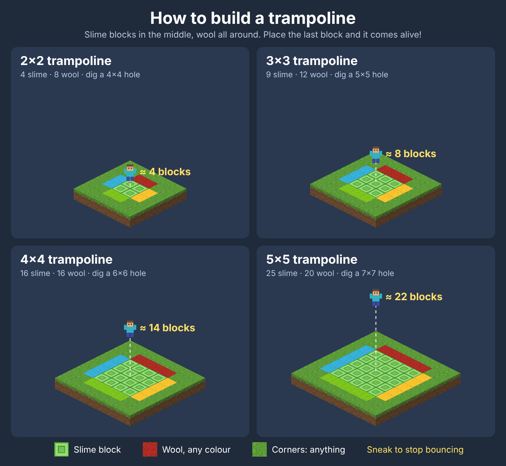

# Trampolines

Build a pattern of blocks, like a Nether portal, and it turns into a trampoline.
Bigger trampolines bounce you higher.



## The starter chest

The first time you join a world with this mod, a chest appears next to you with:

- 100 slime blocks
- 40 planks: oak, birch, spruce, and dark oak
- an iron shovel to dig the hole

And to try the other mods right away (the same as their kits):

- power tools: a drill, a chainsaw, and a power shovel
- 10 golden feathers to fly
- weapons: a pistol, a rifle, and a machine gun, with 320 bullets and 64 grenades

That's enough for the biggest 10×10 trampoline, or lots of small ones.
Everyone gets their own chest, once per world.
If there's no flat spot next to you, everything goes straight into your inventory. A mod that isn't installed just leaves its things out.

## How to build one

1. Dig a hole one block deep. For a 3×3 trampoline, make it 5×5.
2. Fill the middle with **slime blocks** in a square.
3. Put **planks** all around the slime. Any wood works, and you can mix them.
   Want it colourful? **Wool** works too, in any colour, mixed with planks or not.
   The four corners can be anything: planks, dirt, or nothing.
4. When you place the last block, you hear a ding, see sparkles, and the edge turns into black wool. It's ready!

```text
    . W W W .        S = slime block
    W S S S W        W = planks (any wood) or wool
    W S S S W        . = corner, anything
    W S S S W
    . W W W .
```

## Sizes

| Slime square | Hole to dig | Bounces about |
| --- | --- | --- |
| 2×2 | 4×4 | 4 blocks high |
| 3×3 | 5×5 | 8 blocks high |
| 4×4 | 6×6 | 14 blocks high |
| 5×5 | 7×7 | 22 blocks high |
| 6×6 | 8×8 | 30 blocks high |
| 7×7 | 9×9 | 40 blocks high |
| 8×8 | 10×10 | 52 blocks high |
| 9×9 | 11×11 | 66 blocks high |
| 10×10 | 12×12 | 80 blocks high |

## Good to know

- Jump on and you keep bouncing. **Sneak** to stop.
- No fall damage for 10 seconds after a bounce, even if you fly off the side.
- Break any slime or edge block and it stops being a trampoline. Put it back to rebuild it.
- Want different heights? Change `strength` in [`behavior_pack/scripts/trampoline.js`](./behavior_pack/scripts/trampoline.js), then run `npm test` to see the new heights.
